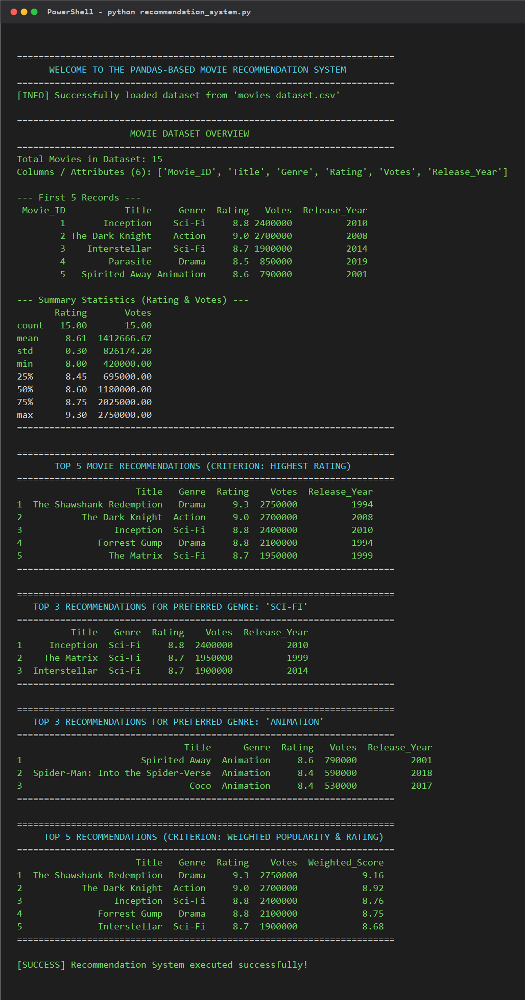

# 🎬 Movie Recommendation System (Python & Pandas)

[](https://www.python.org/)
[](https://pandas.pydata.org/)
[](https://ankitraj-sharma.github.io/movie-recommendation-system/)
[](https://opensource.org/licenses/MIT)

> **College Project: Self-Learning Task 3 (Practical 11)**  
> **Topic**: Develop a Simple Recommendation System using Python and Pandas.

🔗 **Live Interactive Web App**: [https://ankitraj-sharma.github.io/movie-recommendation-system/](https://ankitraj-sharma.github.io/movie-recommendation-system/)

---

## 📌 Project Overview
This project demonstrates how structured data can be processed using **Python and Pandas** to generate recommendations for a real-world application (Movies). It meets all formal requirements of **Self-Learning Task 3**:

- ✅ **Dataset Size**: Contains 15 curated movies (exceeding the $\ge 10$ minimum items requirement).
- ✅ **Storage**: Managed using a structured **Pandas DataFrame** loaded from `movies_dataset.csv`.
- ✅ **Attributes**: Includes 6 relevant attributes (`Movie_ID`, `Title`, `Genre`, `Rating`, `Votes`, `Release_Year`).
- ✅ **Recommendation Criteria**: Implements 3 distinct criteria:
  1. **Criterion 1 (Highest Rating)**: Recommends the Top 5 movies overall.
  2. **Criterion 2 (User Preference)**: Recommends the Top 3 movies filtered by genre (e.g. Sci-Fi, Animation, Action).
  3. **Criterion 3 (Weighted Rating Score)**: Balances rating and popularity using the industry-standard IMDb formula.
- ✅ **Outputs**: Displays clean Top 3 and Top 5 recommendations in tabular format.

---

## 🗂️ Dataset Details (`movies_dataset.csv`)

| Movie_ID | Title | Genre | Rating | Votes | Release_Year |
| :---: | :--- | :--- | :---: | :---: | :---: |
| 1 | Inception | Sci-Fi | 8.8 | 2,400,000 | 2010 |
| 2 | The Dark Knight | Action | 9.0 | 2,700,000 | 2008 |
| 3 | Interstellar | Sci-Fi | 8.7 | 1,900,000 | 2014 |
| 4 | Parasite | Drama | 8.5 | 850,000 | 2019 |
| 5 | Spirited Away | Animation | 8.6 | 790,000 | 2001 |
| 6 | Avengers: Endgame | Action | 8.4 | 1,180,000 | 2019 |
| 7 | The Shawshank Redemption | Drama | 9.3 | 2,750,000 | 1994 |
| 8 | Whiplash | Drama | 8.5 | 900,000 | 2014 |
| 9 | Spider-Man: Into the Spider-Verse | Animation | 8.4 | 590,000 | 2018 |
| 10 | The Matrix | Sci-Fi | 8.7 | 1,950,000 | 1999 |
| 11 | Gladiator | Action | 8.5 | 1,530,000 | 2000 |
| 12 | Coco | Animation | 8.4 | 530,000 | 2017 |
| 13 | Forrest Gump | Drama | 8.8 | 2,100,000 | 1994 |
| 14 | Dune: Part Two | Sci-Fi | 8.6 | 420,000 | 2024 |
| 15 | La La Land | Romance | 8.0 | 600,000 | 2016 |

---

## 🧠 Recommendation Methodology

### 1. Global Highest Rating (Top 5)
Sorts the dataset by `Rating` in descending order, with `Votes` as a secondary tie-breaker:
```python
df.sort_values(by=["Rating", "Votes"], ascending=[False, False]).head(5)
```

### 2. User Preference (Genre Filtered Top 3)
Applies conditional boolean masking for the user's preferred genre, then ranks candidates by score:
```python
df[df["Genre"].str.lower() == user_genre.lower()].sort_values(by="Rating", ascending=False).head(3)
```

### 3. IMDb Weighted Rating Score
Eliminates low-vote bias using the formula:
$$\text{Weighted Score} = \left(\frac{v}{v + m}\right) \cdot R + \left(\frac{m}{v + m}\right) \cdot C$$
- $v$ = votes
- $m$ = minimum votes threshold (25th percentile: $695,000$)
- $R$ = individual movie rating
- $C$ = mean rating of entire dataset ($8.61$)

---

## 💻 How to Run Locally

### Prerequisites
Make sure Python 3 and Pandas are installed:
```bash
pip install pandas
```

### Option A: Run Python Script
```bash
python recommendation_system.py
```

### Option B: Open in Jupyter Notebook / VS Code
```bash
jupyter notebook recommendation_system.ipynb
```

---

## 📸 Execution Output Screenshot


---

## 📁 Repository Structure
```
movie-recommendation-system/
├── movies_dataset.csv            # Structured dataset (15 items, 6 attributes)
├── recommendation_system.ipynb   # Complete Jupyter Notebook with outputs
├── recommendation_system.py      # Standalone Python script
├── index.html                    # Interactive live web demo (GitHub Pages)
├── execution_screenshot.png      # Terminal execution screenshot
├── execution_output.txt          # Plain text log of program execution
├── Project_Report.md             # Formal 5-section academic project report
├── Project_Report.html           # Styled printable report (Print to PDF)
└── README.md                     # Documentation & setup guide
```

---

## 👨‍💻 Author
- **Student**: Ankit raj sharma
- **GitHub**: [@Ankitraj-sharma](https://github.com/Ankitraj-sharma)
- **Course**: Practical 11 - Recommendation Systems (Self-Learning Task 3)
